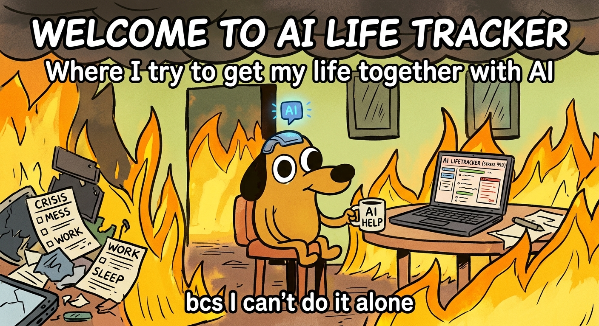

# 🧠 AI Life Tracker

<p align="center">
  
</p>

<p align="center">
  <strong>Trying to get my life together with AI because apparently I can't do it alone. 💀</strong>
</p>

<p align="center">
  An AI-powered personal life management API that generates personalized schedules, manages tasks, and learns from user feedback through context-aware AI interactions.
</p>

---

## About

AI Life Tracker is a backend application designed to help users organize their daily lives with the help of AI.

Instead of generating schedules from scratch every time, the application can use previous schedules and user feedback as context when generating new ones. This allows the AI to take past preferences into account and produce schedules that better match the user's needs.

The project combines a structured backend architecture with an LLM integration to explore how AI can be used to build more personalized and useful productivity tools.

## Features

- **Authentication** — User registration, email verification, login, and token-based authentication.
- **Schedule management** — Create, retrieve, update, and manage personal schedules.
- **Task management** — Organize tasks associated with schedules and track their status.
- **Feedback system** — Submit feedback about generated schedules.
- **AI schedule generation** — Generate schedules from natural-language prompts using Google's Gemini API.
- **Context-aware personalization** — Retrieve previous schedules and feedback to provide relevant context when generating new schedules.
- **Database persistence** — Store users, schedules, tasks, and feedback in PostgreSQL.
- **Containerized development** — Run the application and database with Docker Compose.

## Tech Stack

| Technology | Purpose |
|---|---|
| TypeScript | Type-safe application development |
| NestJS | Backend framework |
| PostgreSQL | Relational database |
| Drizzle ORM | Database queries and schema management |
| Google Gemini API | AI-powered schedule generation |
| Docker & Docker Compose | Containerization and development environment |
| JWT & Passport | Authentication |
| Resend | Email delivery |

## How AI Personalization Works

The application uses previous user interactions as context for future schedule generation.

1. The user submits a prompt describing their scheduling needs.
2. The backend retrieves relevant existing schedules and feedback.
3. The application provides the prompt and retrieved context to Gemini.
4. Gemini generates a schedule based on the available information.
5. The generated schedule is processed and persisted in the database.
6. The user can submit feedback to influence future generations.

For example, if a user requests a schedule and later explains that lunch should be scheduled from 12:14 PM to 1:14 PM, that feedback can be included as context during a subsequent generation.

**The personalization comes from retrieving and reusing stored context, not from retraining the AI model.**

## Getting Started

### Prerequisites

- [Docker](https://www.docker.com/)
- Docker Compose
- API credentials for the external services you intend to use

### 1. Clone the repository

```bash
git clone https://github.com/Aymen-AitOuraies/LifeTracker.git
cd LifeTracker
```

### 2. Configure environment variables

Create your local `.env` file using the example:

```bash
cp .env.example .env
```

Fill in the required values for your environment. Do not commit your `.env` file or expose API keys and authentication secrets.

### 3. Start the application

```bash
docker compose up --build
```

The application and PostgreSQL database will start through Docker Compose.

### 4. Access the API

Once the application is running, the API is available at:

```text
http://localhost:3000
```

If Swagger is enabled in the application, use the Swagger UI route configured in the project to explore the available endpoints.

## Development Commands

The project includes a Makefile to simplify common development tasks.

```bash
make dev
```

Start the development environment.

```bash
make down
```

Stop the containers.

```bash
make logs
```

View application logs.

```bash
make generate
```

Generate database migrations using Drizzle Kit.

```bash
make migrate
```

Apply database migrations.

```bash
make clean
```

Remove containers and the associated Compose volumes.

**Warning:** `make clean` may permanently delete the PostgreSQL data stored in Docker volumes. Use it only when you intentionally want to reset the environment.

Check the `Makefile` for the exact commands configured in your current version.

## Project Structure

The application follows a modular NestJS architecture, separating features into dedicated modules.

```text
LifeTracker/
├── src/
│   ├── ai/
│   ├── auth/
│   ├── schedules/
│   ├── tasks/
│   ├── feedbacks/
│   ├── db/
│   │   └── schema.ts
│   ├── app.module.ts
│   └── main.ts
├── drizzle/
├── docker-compose.yml
├── Dockerfile
├── drizzle.config.ts
├── Makefile
├── .env.example
└── package.json
```

*The structure above illustrates the main modules and configuration files; adjust the paths if your repository differs.*

## Current Status

AI Life Tracker is an ongoing project focused on combining backend engineering with practical AI integration.

The current implementation includes authentication, persistent schedule and task management, user feedback, and AI-assisted schedule generation with contextual personalization.

## Future Improvements

- Build a frontend for schedule creation and visualization.
- Improve scheduling constraints and validation.
- Expand automated testing and API documentation.
- Add more personalization options and richer scheduling workflows.
